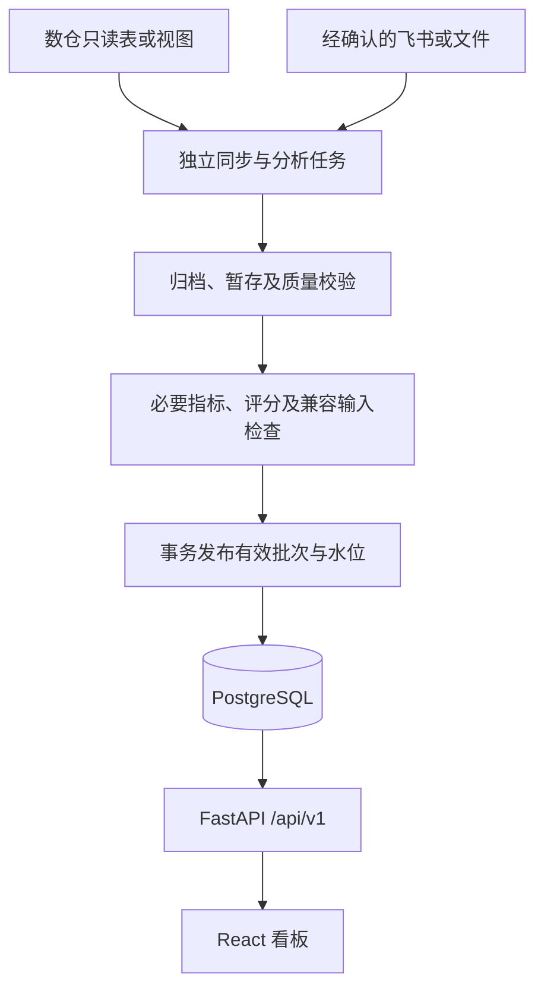

# 架构基线

更新日期：2026-10-27。本文只维护全局技术选择、组件职责、数据流及运行/切换边界；数据库设计从头按[用户流程](database-design.md#database-design-process)推进，不表示均已实现。进度只见 [TODO](../TODO.md)，页面范围见 [需求](requirements.md)，字段、指标与接入契约见 [数据契约](data-contract.md)，调查事实见 [来源证据](source-evidence.md)。

线上源码已获取，作为只读参考；实际开发在独立重构项目中进行。两处地址统一见[README的源码与重构目录](../README.md#源码与重构目录)。

## 已确定技术与职责

- 独立单仓库、模块化单体：一个 React/TypeScript 前端，一个 Python/FastAPI 应用；同步、评分、售后分析为独立进程，与 API 共用领域逻辑。
- PostgreSQL作为已选应用主库，承载在线查询、必要事实、规则结果、版本和任务记录；2026-10-27用户再次确认该选择。必要原始文件、模型输入及报告独立归档，不复制整个数仓或无关个人明细。
- 应用库用于隔离页面负载、统一历史修正和运行记录，不是因为文件不能持久化或十万条数据必然需要数据库。未来数仓若提供完整、有性能保障的服务，须经验证和决策记录后才简化，并保持接口稳定。
- 用户确认前期不引入Redis，后期根据实测及实际需求评估。首期也不增加微服务、消息中间件或通用ETL平台；新增依赖须有测量或明确需求。真实AI目标不等于模型服务、费用及数据使用边界已经确定。

| 层         | 技术与边界                                                                                                      |
| ---------- | --------------------------------------------------------------------------------------------------------------- |
| 页面与路由 | React、TypeScript、Vite、React Router；一个前端工程                                                             |
| 控件与图表 | M1 已采用 Ant Design、Ant Design Icons、Recharts、dayjs；局部主题不强制其他模块改版，不引入第二套图库           |
| 查询与契约 | TanStack Query、fetch、Zod 运行时校验；OpenAPI描述实际传输结构，口径以data-contract为准；后续生成TypeScript类型 |
| API        | Python 3.12+、FastAPI、Pydantic；前缀 `/api/v1`                                                                 |
| 数据访问   | SQLAlchemy 2、Psycopg 3、PostgreSQL；不静默退回 SQLite                                                          |
| 迁移       | Alembic；不在启动时 `create_all` 建业务表                                                                       |
| 任务       | 独立 Python CLI 或公司调度器；数据库协调任务、批次和跨进程锁                                                    |
| 部署       | 公司服务器、静态前端、API、同源反向代理；本机数据库沿用现有Docker Compose，线上数据库托管方式按公司运维条件确定 |

Node 与 Python 依赖按项目锁文件维护；启动和检查见 [README](../README.md)，协作和提交规则见 [AGENTS](../AGENTS.md)。

| 位置                                     | 职责                                                       |
| ---------------------------------------- | ---------------------------------------------------------- |
| `apps/web/src/app`、`features`           | 导航、业务页面组合、交互、格式化及展示                     |
| `apps/web/src/shared`                    | 实际复用的展示组件、接口客户端和生成类型                   |
| `apps/api/app/api`、`core`               | 协议校验、异常映射、身份、配置、日志和请求标识             |
| `apps/api/app/modules`                   | 各域指标、规则、契约、仓储；路由不承载业务计算             |
| `apps/api/app/db`、`apps/api/migrations` | 连接、模型、事务及可审查迁移                               |
| `apps/api/app/jobs`                      | 按需建立独立任务；连接器负责分页、映射、归档和上游错误分类 |
| `var/` 或私有归档                        | 本地导入、归档和日志，不提交 Git                           |

以上是职责边界，不提前生成空服务或全部业务表。页面模块不等于独立服务/数据库；评分归商品域，中心复用各域服务，不另造摘要口径。售后展示统一为 React；公共能力按真实复用提取。

前端通过开发代理、生产同源反向代理查询应用 API，不直连数据库、飞书或数仓，不导入业务大快照。正式汇总、同比、评分、告警由后端确定性计算；AI 文案绑定证据和输入版本，规则诊断明确依据，不冒充 AI 或人工进度。合成开发样例与生产链路隔离，失败不回退样例。M1默认正式查询：先取得经营版本、再并行查询独立作用域；评分另锁结果版本。`wire.ts`负责正式响应校验/展示映射，`display.ts`只做精确十进制格式化，不计算正式经营指标。图表只把绘图坐标转Number，提示读原串；分页目录不会使未返回的已选商品被误删。接口DTO/OpenAPI与真实PG响应验证，语义不脱离数据契约。

共享看板壳放在`apps/web/src/shared/layouts/`：`DashboardLayout`统一顶部导航、组件库主题和页内目录组合，`dashboardNavigation.ts`维护五页站内入口，业务页只提供当前页面、区块与正文。桌面目录占左侧全屏高，顶部导航与正文放在同一右侧内容列，随目录收缩共同调整宽度；窄屏恢复顶部导航、横向目录、正文的排列。顶栏高度及桌面锚点避让由布局统一管理；目录组件本身支持无顶栏复用。共享壳不导入任何业务feature、接口、查询状态或样例；商品页样式只保留业务内容。其他占位页面接入时复用该壳，不复制现有导航。

M1首屏避免重复加载：经营与明细目录仅在实际目录条件相同时复用当前响应，筛选状态仍独立；明细默认日期直接使用全局推荐窗口，评分取得独立score_version后再请求。仓储在单个只读事务的ProductView内复用相同商品目录查询，返回独立副本；不同条件/日期分别查询，事务结束即释放，不跨请求缓存，也不跳过发布版本或覆盖校验。

## 数据存储与查询边界

PostgreSQL是应用的持久化与在线查询主库，按业务域承载必要事实、规则/评分产物以及运行发布记录；各页共用项目库，保持身份和版本职责一致。数仓是只读上游，独立任务完成接收、校验和发布，API只查询应用库。经营历史、必要原始输入和备份各有职责，保存多少及怎样恢复须有明确方案。

- 事实按真实业务粒度保存，公共身份/资料与经营度量分开；原型卡片和页面数量不决定表数。
- 基础事实及相容结果通过事务与版本协调发布，读请求固定一致视图；元信息不能替代历史事实备份。
- 当前不增加Redis或独立共享缓存；查询复用、物化或缓存的引入依据实际负载，并有失效/重建安排。
- 数据库结构通过Alembic演进，读、任务、迁移身份分离；先形成具体设计与实施方案，再在获准范围执行并做真实PostgreSQL验证。

数据库对象、关系、表字段及实施方案从头按[用户流程](database-design.md#database-design-process)重新设计；既有M1结构不作为新设计前提。详细设计独立留档，架构文档只维护全局边界；当前运行状态和进度只见TODO。

### 主库适配理由、缓存条件与环境建议

本项目的店铺、链接、款式、资料、目标、事实及分析结果具有明确关系，需要关联查询、唯一/外键约束、精确金额和一致发布。[PostgreSQL关系约束](https://www.postgresql.org/docs/17/ddl-constraints.html)、[NUMERIC](https://www.postgresql.org/docs/17/datatype-numeric.html)及[事务隔离](https://www.postgresql.org/docs/17/transaction-iso.html)适合这些要求；现有Python/SQLAlchemy/Alembic技术栈也已有对应支持。这是本项目采用PostgreSQL的理由，不是未经压测的容量或响应时间保证。

先通过合理索引、后端分页、消除重复查询和必要后台汇总/评分改善查询；按实测选择汇总表或[物化视图](https://www.postgresql.org/docs/17/rules-materializedviews.html)，并绑定输入版本及刷新状态。任务先按现有独立进程和数据库协调边界设计，不能把Redis作为启动后台任务的前提。

Redis的后续引入条件是：实际高频重复查询已形成可测瓶颈，经过SQL/索引/汇总优化仍达不到批准目标，或出现已经明确的跨实例共享状态需求。若选择缓存，按[Redis cache-aside机制](https://redis.io/docs/latest/develop/use-cases/cache-aside/)定义失效及TTL；缓存键包含授权范围、规范化筛选、数据版本及必要规则/评分版本。缓存可由主库重建，事实和任务成功记录仍持久化在PostgreSQL；容量、失效及故障时的受控回源先验证。

下表为环境部署建议，尚未执行线上部署或环境配置：

| 环境       | 数据库与进程                                                                                                | 数据、配置和验证边界                                                                                                                                                                         |
| ---------- | ----------------------------------------------------------------------------------------------------------- | -------------------------------------------------------------------------------------------------------------------------------------------------------------------------------------------- |
| 本地开发   | 沿用现有Docker Compose PostgreSQL；前端、API和独立任务可在本机运行                                          | 当前配置固定PG17镜像，仅绑定本机地址并使用持久卷；连接和凭据走各自环境配置，数据及凭据不入Git。开发资料使用获准的必要样本或合成数据。                                                        |
| 自动化测试 | 真实PostgreSQL独立测试库，继续与开发/业务库隔离                                                             | 测试可演练新迁移升降、事务、约束及恢复；不能对业务库运行破坏性测试，SQLite不替代PG验证。                                                                                                     |
| 预发布     | 与生产主要数据库版本、扩展和运行方式一致的隔离环境                                                          | 先验证新Alembic迁移、接入、对账、权限、性能和备份恢复；使用独立账号和数据，不能共享生产写入环境。                                                                                            |
| 公司生产   | 优先复用公司已有且满足要求的受维护PostgreSQL服务；没有合适服务时，按运维能力在公司Linux服务器部署独立PG服务 | API与任务独立进程，数据库通过私网提供服务；可以同机起步但须验证资源隔离、查询/任务预算及磁盘容量，独立数据库环境不等于首期必须购买独立物理机。数据库容器化可选，须有持久盘、运维和独立备份。 |

版本建议：现有本地配置为PostgreSQL 17，仍在[官方支持范围](https://www.postgresql.org/support/versioning/)内；本期可沿用17作为本地、测试、线上统一基线，固定经验证镜像并维护安全/缺陷小版本。若公司正式平台要求其他受支持大版本，先统一验证再决定，当前不自动升级任何环境。

代码与新Alembic迁移随版本交付，开发、预发布、生产各自从获准来源初始化和更新；生产不直接采用本地开发库或旧M1数据。应用启动不自动建表，发布时由迁移身份执行经验证的新迁移，API查询、任务写入、迁移身份分开。生产前按已有要求落实认证授权、HTTPS、私网访问、监控、独立备份和恢复演练；[PostgreSQL备份机制](https://www.postgresql.org/docs/17/backup.html)及需要时的WAL/PITR按批准的可容忍丢失量和恢复时间配置，不预设硬件规格或未经测量的SLO。持久卷用于持久化，不替代独立备份。

## 同步、时间一致性与失败恢复

1. 同一业务范围仅一个生效来源，候选来源隔离对账后切换。核验历史覆盖、公式依赖、更新、删除和回补；故障不自动混读飞书。不同来源事实只关联/对账，不因同名相加。
2. 首次导入约定历史范围；可靠修改时间/CDC可用时增量，否则按范围重拉及周期对账。UPSERT依赖业务唯一约束；删除须有标记或证明完整的范围快照，不能用“未读到”冒充删除。
3. 获取跨进程执行锁，记录输入版本、覆盖、阶段和结果；校验字段、重复、金额、缺数、回退与覆盖，关键错误阻止发布。去重、租约恢复、有限重试、超时、补跑须可追溯。
4. 汇总/评分绑定兼容输入批次，发布指针、相关状态与水位在事务内切换；失败不推进水位、不损坏旧有效版本。事务提交失败回滚；发布后业务问题按可恢复归档/保留范围修复并重新发布，恢复经验证才宣称可回退。
5. 单个请求须在 PostgreSQL REPEATABLE READ只读事务/一致快照内校验版本并查事实，不能读完版本换快照；仅加batch_id不自动形成历史快照。不支持旧版本继续查询时返回409，前端整组重取。
6. 基础发布后评分/AI未重算时明确pending或旧结果及日期，不能冒充当前结果。Asia/Shanghai为业务日期时区，运行时间带时区；各域可不同截止日，关联必须兼容，不伪造全局同一天。
7. 接口显示实际覆盖、完整性、最后尝试/成功、版本与失败原因；无上游完成标记只能报告已观察范围，最大日期或请求成功不证明完整最新。

用户刷新只查有效数据；受权手动同步登记/复用后台任务，不在请求内读取全量上游或计算模型，不在每个 API worker 启动调度器；线程锁不能替代跨进程协调。

### 自动同步、手动补跑和历史修订（2026-10-28已授权）

本机采用**定时自动同步为主、手动同入口补跑为辅、范围内历史修订重查兜底**。已接入来源通过独立项目编排入口串行接收；尚未实现的模块不产生假同步。这些是同一套连接器/校验/发布流程的不同触发入口，不另建手动导入的一套口径。已有task_runs、dataset_versions、version_inputs、current_datasets、coverage_records承载尝试、幂等版本、输入、当前发布和覆盖，本次不为调度增加物理表或Redis。

| 来源/交付               | 后续可选触发能力（未启用）                                                                                                  | 仍须核实的来源事实                                                                                                      |
| ----------------------- | --------------------------------------------------------------------------------------------------------------------------- | ----------------------------------------------------------------------------------------------------------------------- |
| 数仓已选BWD/ADS/RPA结果 | 每日主同步放在上游成功交付后；日间有不定时更正时增加变更检查。每小时检查可作首期候选，不等于每小时全量重拉或已经配置        | 正式完成标记/批次、更新时间含义、时区、业务键、修订删除和访问额度；只见网页时间不证明整批已完成                         |
| 聚水潭相关数据          | 优先同步已经选定的数仓加工/实际J1/J2/J3交付；有稳定交付批次/文件时随交付处理，没有时按实际更新周期轮询                      | 不能假设当前已授权直连ERP API/事件；确认实际交付入口、覆盖窗口、重导/修订及完整性，不重复接同一逻辑数据的直连和数仓两份 |
| 飞书资料/目标/退款等    | 已选数仓镜像的逻辑数据集从数仓同步；确需飞书为生效源时，周期检查或有已核权限/可靠事件后触发；资料/目标30—60分钟检查仅为候选 | 事件、字段修改时间、分页与删除语义、权限和限额是否支持；没有证明事件可靠前仍用周期对账兜底，不因webhook到达就发布整批   |

调度时区固定Asia/Shanghai，初始每日10:00、14:00、18:00；唯一运行配置为`config/sync.toml`，每次检查重新读取，可用`scripts/sync-project.py --set-times`调整。独立launchd每分钟检查，单个项目入口持PG全局advisory锁并用task_runs按时间槽去重/最多两轮尝试；域任务仍用各自锁/租约。旧三个手工job入口同样受项目锁保护。每个数仓reader全部查询共享最多3次资源并发拒绝重试（2/6/15秒），普通语法/权限错不重试；不把本轮backend报错中的3推定为账号/全局额度。失败来源留旧版，独立来源继续，失败详情与成功时间分开。

本机已登录且机器/数据库可用时执行；关机/睡眠不能按时运行，恢复后当日漏点合并为最近一个时间槽，跨日自动补跑未启用。配置/调度独立于API，不在每个worker重复启动；公司生产调度、监控及运行环境仍另行验收。M1源与关系成功后才运行相容试行评分；源变而评分未出时隐藏旧分。页面45秒及聚焦轻量检查本地元信息，新版本重取并取消旧请求；默认日期推进，自选日期及其他筛选保留。

当前手动更新使用同一CLI编排入口，返回任务/来源结果；网页手动提交任务的界面尚未实现。后续后台入口须立即返回任务ID/已有运行状态；选择来源、数据集和必要业务期间，指定期间补跑仍受原来源范围/权限和预算限制。若同逻辑范围已有任务在跑，登记/复用该任务或受控排队，不随点击量新增上游并发；手动任务与自动任务共用PostgreSQL互斥/租约和现有running唯一约束。普通看板刷新仅重读本地已发布结果，既不触发上游拉取，也不把接口等待变成长时间同步。用户只看当前真实进度、最后尝试/成功、实际截至/完整日和失败原因。

**增量及历史更正。** 有可靠修改时间/游标及稳定业务键才按增量读取，并使用交叠回看、分页同批/范围校验；dt通常是业务日，create_time通常是创建事件，均不自动充当修改水位。没有可靠增量时，按获准的完整范围快照/受控回看窗口重取并比对摘要；最近N天只能捕获窗口内修订，仍需周期更大范围对账与指定期间补跑，不能承诺旧退款或月结修订永远落在N天内。缺记录不代表删除；实际删除只依据明确删除事件/标记或已核完整枚举的范围快照，生成新版本并保留旧输入。当前项目编排对固定六店/批准日期范围执行两次完整分页且投影一致，再以受控reconcile_full_scope记录移除键/身份变更计数并发布新版本；既有行/版本不DELETE。普通未证明全范围的入口仍拒绝不明缺键；空商品/资料交付继续拒绝。读取枚举稳定不等于业务齐数，源软删除标签含义未证时只保留原值，不猜其业务效果。

**一次同步的边界。** 读取交付/固定批次→校验结构/键/单位/范围/完整性→在不可变候选版形成相容内容→短事务原子发布当前入口/可靠水位→按依赖重算资料关系、评分/报告→公布真实状态。上游有快照/批次令牌就固定它；分页读取中途上游变化且无法证明相容时不能把混批当完整成功，应有界重读或保留候选并说明缺口。源拉取不持有长时间发布事务/当前入口锁；数据无语义变化时复用已存内容版，但仍记录本次实际尝试与来源时间观测。新事实可先发布，依赖旧评分时明确待重算；未验依赖不拼成“全正常”。

首期单来源串行起步，跨源总并发仍按核实预算控制；执行互斥与失败接管复用[PostgreSQL锁机制](https://www.postgresql.org/docs/17/explicit-locking.html)及现有任务设计，发布/读取的一致性依据[事务隔离](https://www.postgresql.org/docs/17/transaction-iso.html)。调度到点不保证上游已有新数据，也不代表业务齐数。M3完成额随shop_daily新版本按已确认方案A重新汇总，已发布历史售后报告仍固定旧输入；更新历史报告须生成新报告修订。

“上游最多5并发”尚未确认，连接与查询、账号/资源组/全局、独享/共享、队列/拒绝及同步额度分别核实。连接池和任务遵守总预算，不随用户或API进程数放大。

## 接口、运行与安全

- 正常 `data/meta`、错误 `error`；日期边界、稳定排序、分页上限、状态按数据契约。取消旧请求/防旧响应覆盖，缓存隔离筛选、授权和数据版本；不可用、空结果、局部缺失、零值、过期、失败分别显示。
- 健康接口不冒充经营接口。无 `DATABASE_URL` 可看本机页面但 readiness返回503；连通不等于迁移或业务验收。
- 首次公司共享访问前完成认证、授权、HTTPS、可信网关、同源代理和服务托管；CORS不是认证，不信任客户端自填身份头，浏览器业务写入具备相应防护。
- 应用库与上游只读账号隔离并最小授权，同步使用获准的稳定身份。日志含request_id/run_id、阶段、批次、行数、耗时和结果，不含凭据、完整导入行或敏感参数。
- 私库不能代替秘密隔离；凭据、归档、备份、日志、依赖及构建产物不提交。数据库和原始输入分别备份、独立存放，恢复至测试实例对账后才确认恢复可用。
- 日聚合36个月、重要月汇总5年、可重建快照30—90天仅未批准建议；不可重建材料另定。自动清理默认关闭；生产发布、源系统写入及删除须明确授权。
- 上线前完成同步限流、监控、新老对账、备份恢复、回退和责任人。实际并发、查询/首屏延迟、内存和同步耗时实测后设SLO，不将历史规划目标当保障；证据见 [验证](validation.md)。

架构变更记录日期、事实、方案和迁移影响；页面和来源细节在各自主文档维护，不因局部需求无依据切换架构。

## 新旧系统怎样切换和停止维护

### 按实际使用范围逐步替换

先完成一个页面或一条完整业务操作的核对，再让限定范围的获准用户试用；检查数据、操作、性能和更新情况后扩大范围。优先按看板或明确用户范围切换，是否需要流量比例由实际入口和使用规模决定，不预设百分比、观察天数或秒级回退目标。

需要保留旧URL或响应时，才在路由、反向代理或适配入口处理兼容（Facade）；指标规则仍在业务域，不放进转发层。适配入口要登记服务对象、维护人及删除条件，消费者迁完、观察期结束且回退安排确认后才能撤销。没有过渡适配需求时不额外增加这一层。

### 每次切换前写清操作单

| 项目           | 必须说明的内容                                                                                                               |
| -------------- | ---------------------------------------------------------------------------------------------------------------------------- |
| 切换对象       | 哪个页面、哪些用户或入口，旧/新地址、代码版本、数据截至日及实际可用范围。                                                    |
| 进入条件       | 对应契约已确认，数据比对与分层验收有记录，权限、同步和备份恢复满足本次范围；未解释差异不能带过。                             |
| 观察与停止条件 | 谁看哪些监控；金额偏差、权限错误、错误率、响应时间和更新延迟到什么程度暂停扩大或切回，阈值依据是什么。                       |
| 回切步骤       | 谁决定、谁执行、通过哪个入口切回，路由/缓存/账号及任务怎样处理，切回目标时间和实测耗时，如何确认旧入口仍能提供可接受的数据。 |
| 通知和记录     | 业务对口人、技术及运行负责人、来源联系人，变更影响、切换前通知、异常处理及最终确认记录。                                     |

核心指标出现超过约定容差的未解释差异、越权、持续不可用或延迟超标时，先停止扩大使用范围，再按已批准预案处理；一般问题是否阻断由实际业务影响决定，不机械要求“零P2”。切换期增加必要观察，但告警阈值仍按实测和风险设定。

操作单须在预发布或经确认的隔离环境做一次推演或演练，走通发现异常、决定、执行和结果复核，并记录实际耗时。演练条件不具备时写未完成，不能拿代码检查、接口健康或本机单次计时代替。

### 入口回切与数据恢复分别验证

切回旧页面不会自动撤销已经写入PostgreSQL的数据。事务提交前失败可回滚；提交后的错误按权威来源重读修复或独立备份恢复流程处理，不靠拨回发布指针恢复被覆盖事实。若多个版本共用同一数据库，先验证结构变更的兼容顺序；独立运行的旧工程不因此被要求读取新库。具体恢复验收见[验证文档](validation.md#layered-acceptance)。

本次上线所需的现网回切能力，与历史实验代码及旧目录的归档决定分开。先核实当前旧入口、任务和必要材料是否还可用；不可用就记录缺口并重新确定切换办法，不自动恢复已放弃的历史资料。

### 旧系统和适配入口何时停止维护

退役前须确认：目标使用范围已全部迁移，达到事先约定的稳定观察期；旧链接、摘要、订阅和人工报表等依赖已核对并获得消费方确认；完成最终数据比对，回切或恢复安排仍有效。停止旧任务和撤入口单独审批，不删除上游共享资源或未经批准的输入。

并行前列出旧/新系统维护人、机器和存储、上游读取及对账工作量，确认复核日期和计划结束日期。到期未完成要说明剩余依赖、额外成本和调整决定，避免无限期双维护；没有测量或批准时不填预算数。

每个交付单元确认业务对口、开发、来源和运行恢复责任，未指定的人写待确认，不从商品资料的“运营”字段推定负责人。交接材料至少能让接手者找到指标定义、来源路径、页面设计依据、复测入口、验收记录和回切步骤，按README入口阅读，不另建重复正文。
