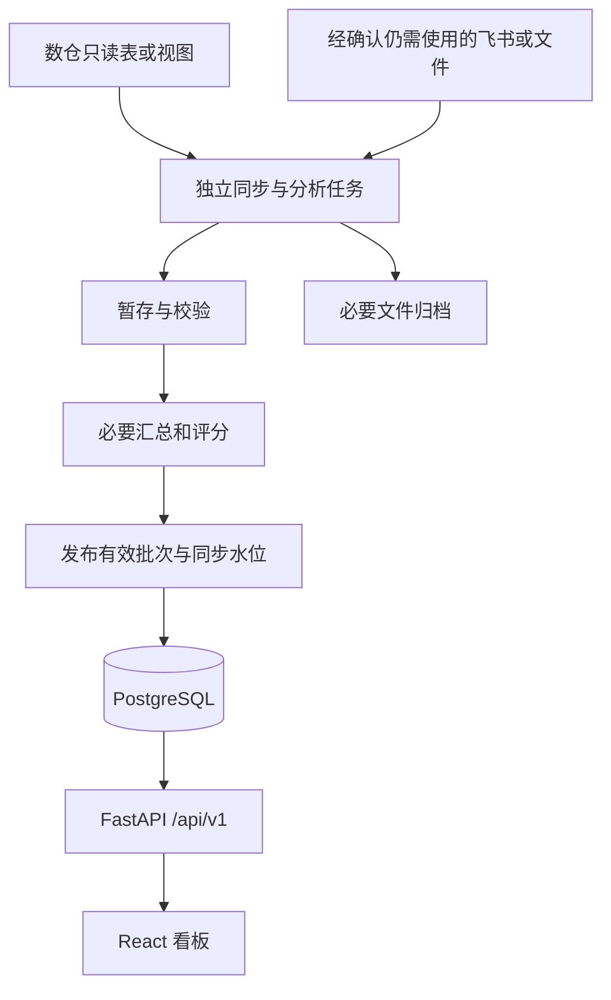

# 架构基线

日期：2026-10-21。本文区分选定方向、初始化已实现能力和待核实条件；不是生产可用性承诺。

## 决策

采用单仓库、模块化单体：一个 React/TypeScript 前端，一个 FastAPI 应用；同步、评分、售后分析作为独立进程运行。PostgreSQL 承载在线查询与应用记录，必要文件用于归档与重算。首期不使用 Redis、微服务和消息中间件。

选择应用查询库是为隔离页面负载、统一历史修正和运行记录，不是因为快照无法持久化，也不是因为十万条数据必须用数据库。数仓若最终提供完整且有性能保障的服务，允许依据验证结果简化，但需记录决策并保持查询接口稳定。

上游并发“可能为 5”尚未确认，不将其写成已知服务器配置。需核实连接/查询、账号/资源组/全局、独享/共享、队列/拒绝及同步配额。

## 数据流



用户刷新仅查询有效数据；手动同步创建/复用后台任务。无论页面请求多少，后台遵守约定的上游全局预算。运行中的旧有效版本保持可查询。

## 代码边界

```text
apps/web/src/
  app/                  导航、路由、全局服务
  features/             overview、sales、products、promotion、aftersales
  shared/               接口客户端、生成类型、公共组件
apps/api/app/
  api/                  路由、协议与异常映射
  core/                 配置、日志、请求标识
  db/                   连接、模型与事务
  modules/              各业务域的服务、仓储、契约
  jobs/                 独立同步与分析入口
apps/api/migrations/    Alembic 版本迁移
docs/                   决策、契约、部署与验收
var/                    本地导入、归档和日志；不提交
```

初始化只创建真正使用的目录与最小服务，不提前生成空的多层微服务或所有业务表。

## 技术栈

| 层         | 选择                                | 说明                                                   |
| ---------- | ----------------------------------- | ------------------------------------------------------ |
| 页面       | React、TypeScript、Vite             | 一个前端工程，不继续分成四个 React 项目                |
| 路由和请求 | React Router、TanStack Query、fetch | 请求缓存不等于上游同步；按数据版本失效                 |
| 图表       | 首条链路确认后选型                  | 不为初始化引入多套图表/组件库                          |
| API        | Python 3.12+、FastAPI、Pydantic     | OpenAPI 是接口事实来源，后续生成 TS 类型               |
| 数据访问   | SQLAlchemy 2、Psycopg 3             | 使用 PostgreSQL，不悄悄退回 SQLite                     |
| 迁移       | Alembic                             | 数据表变更可审查，不在服务启动时自动建业务表           |
| 任务       | 独立 Python 进程或公司调度器        | 在数据库中协调跨进程任务和记录批次；具体执行器 P3 落地 |
| 部署       | 公司服务器、同源反向代理            | 容器可按运维要求增加，本地开发不要求 Docker            |

## 存储与查询

- 表按业务粒度组织，避免每指标一表或不同粒度硬塞一表。候选域：商品日、推广日、店铺日、地区日、月度目标、售后期间、评分结果、同步运行与发布批次。
- 业务唯一键、来源记录 ID、数据库主键分开考虑；缺失关键标识的记录隔离，不能静默构造不稳定键。
- 金额精度按来源和计算需要确定，不预先把所有金额截成两位。展示舍入与存储精度分开；比例保留分子分母。
- 前端只拿当前汇总、趋势和明细页。按真实 SQL 设计索引并测试执行计划，不缓存所有 ID 来替代关系查询。
- 常用慢汇总在相关数据发布过程中更新；不生成所有筛选组合。记录版本，不让新明细搭配旧统计。
- 应用只保存页面查询、规则及追溯所需数据，不复制整个数仓或无关个人明细。

## 同步及发布

1. 首次导入约定历史范围；修改时间/CDC 可靠时增量取数，否则按范围重拉与周期对账。
2. 业务唯一约束配合批量 UPSERT；仅 UPSERT 不能识别上游删除。完整范围核对或删除标记另行处理。
3. 校验字段、重复、覆盖、数据量变化、来源版本和数值。空值、缺数、真实零值不同。
4. 发布相关领域的一致版本；失败不推进水位，不影响旧版本。跨域更新不强迫所有来源使用同一天，但相关评分需要匹配输入批次。
5. 任务记录用于去重、租约恢复、重试和手动补跑。API 多进程不是多个调度器；线程内锁不能代替跨进程协调。
6. 下游接口返回实际数据范围、完整日状态、同步成功时间与版本。上游没有完成标记时只能报告已观察范围，不可宣称完整。

## 接口与交互

- `/api/v1` 路由版本化，正常返回 data/meta，错误返回 error；字段规范见 `data-contract.md`。
- 初始系统接口只说明骨架和依赖状态，不返回经营数据。缺数据不自动返回经营零值。
- 页面读取与“同步上游”是两种动作。保持筛选与分页合理性，过期、失败和局部缺失清楚可见。
- 同比、环比、买家与订单、广告与全店交易额严格区分；旧实现错误先记录再修正，不机械复制。
- 规则诊断先显式显示依据，不冒充大模型。真正 AI 分析与任务闭环另行验收。

## 运行与安全

- 初始化仅监听本机，尚未接入公司登录；生产暴露前完成身份与权限设计。
- `DATABASE_URL` 未配置不阻止本地查看骨架，但 readiness 返回 503。数据库连通也不等于迁移完成或业务最新。
- PostgreSQL 账号与数仓只读账号隔离；CORS 不是认证，不能相信客户端自行填写的身份头。
- 凭据、归档、备份与本地日志不提交 Git。GitHub 私有也不能替代凭据隔离。
- 数据库备份与输入归档分别管理；备份独立存放并做恢复测试。
- 保留期限建议：日聚合 36 个月、重要月汇总 5 年、可重建接收快照 30—90 天；业务确认后再启用清理。不能重建的模型/报告输入另定期限。
- 测量实际并发、查询延迟、首屏、内存和同步耗时后设 SLO；不承诺用了 PostgreSQL 就天然快速或正确。

## 当前实现边界

已实现：前后端骨架、路由占位、系统状态、存活/依赖就绪检查、环境变量、连接与迁移入口、基础检查与测试配置。

未实现：业务表、经营查询、上游连接器、导入、同步调度、评分、报表、认证、生产部署。页面明确为初始化，不复制旧数据，不跑任何上游任务。

## 变更规则

影响数据来源、存储职责、权限、规则或部署边界的变更，记录日期、事实依据、采用方案和迁移影响。产品细节可以逐步补充；不因一个局部优化需求重新切换整个架构。
