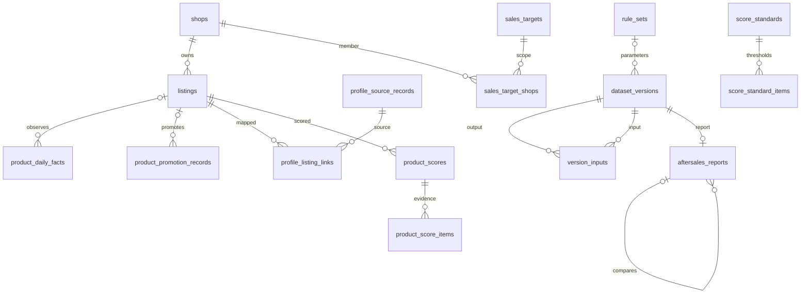

# 数据库设计流程与30表关系

本文保留用户给出的设计流程、业务对象和当前30张表的关系。用户已选择精简后的30表方案；本轮已按审查修正六处问题并收敛字段；完整字段、PK/FK、可空和唯一约束统一在[字段设计](database-schema/README.md)维护，旧72表字段设计不再作为现行方案。现已按用户授权生成独立Alembic基线与离线审阅SQL，专用方案见[迁移与审查计划](database-schema/migration-plan.md)；执行边界及真实验证见专用方案；来源尚未接入。进度及授权见[TODO](../TODO.md#当前任务与范围)。

设计依据：前端原型以`operations-dashboards-source-backup-20261023-155031/sites-current`为准，页面所需展示数据主要见[数据契约第3.5节](data-contract.md#page-display-contracts)。

## 设计流程

1. **识别业务对象。** 明确页面要展示哪些数据，从页面、用户流程和核心功能中整理业务对象，判断哪些对象需要成为核心表。
2. **确认对象关系。** 想清楚对象之间、表与表之间的关系。
3. **写清关联设计。** 列出每张表代表的对象、表间关联、关系基数（1:1、1:N、N:M）、关联字段放在哪张表，以及设计理由。
4. **确定数据库服务。** 使用关系型数据库PostgreSQL；前期缓存边界及本地/线上环境建议统一见[架构说明](architecture.md#database-environments)。
5. **设计表结构和字段。** 按第一、第二、第三范式进行设计。
6. **提前规范常见字段。** 统一命名、标识、日期时间、数值、状态等公共字段的规则。
7. **先保留设计文件，再建表。** 设计方案保存为专用文档；任何结构变更必须先修改migration并说明原因，重新生成派生schema.sql并完成审查，再按用户确认范围操作数据库。已执行revision不改写，后续追加revision。
8. **先写实施计划，再动手。** 实施计划包含业务对象、对象关系、主数据库、缓存架构、核心表、业务职责、字段规范、数据约束、表间关联、删除策略、范式校验、更新策略和验收标准。

## 设计目标

设计清楚、查询快，保证数据一致性和完整性；可拓展、减少冗余、避免更新异常，考虑并发安全和锁冲突；便于维护、排障、迁移和对接，控制存储成本，提供应用层容错并降低业务代码复杂度。

## 第一步：业务对象识别

下表记录业务对象，逻辑表及关联设计见[第二、三步](#table-relationships)；对象与表不要求一一对应，当前物理范围为下述30张。范围覆盖[数据契约3.5](data-contract.md#page-display-contracts)五页全部中文展示字段；主要业务来源为数仓、聚水潭和飞书表。天气另外设计。

用户查看和核查的业务过程：识别店铺及商品资料 → 查看销售、流量、推广、发退货表现 → 对照目标和标准 → 查看评分、诊断与预警 → 查看建议动作及有真实依据的处理情况。页面筛选、单款下钻和跨页定位始终要能识别同一业务对象。

| 范围       | 业务对象             | 含义及承担的展示内容                                                                                          |
| ---------- | -------------------- | ------------------------------------------------------------------------------------------------------------- |
| 基础资料   | 店铺                 | 各业务来源对应的经营店铺、店铺标识和名称。                                                                    |
| 基础资料   | 运营人员             | 商品对应运营、业务责任人员；业务岗位与真实人员分别表达，不从岗位文案推定已指派人员。                          |
| 基础资料   | 产品款式             | 企业内部识别的单款产品，涉及款号、款式编码和款式名称。                                                        |
| 基础资料   | 商品SKU              | 具体颜色、尺码或规格的货品；保留来源编码，ERP编码与平台规格标识不直接等同。                                   |
| 基础资料   | 店铺商品链接         | 某店铺上架的销售链接，涉及商品ID、名称和上架信息；与产品款式、SKU分别识别。                                   |
| 基础资料   | 品类                 | 运营品类、产品分类、虚拟分类及各自分类体系，不直接合并不同含义的分类。                                        |
| 基础资料   | 地区                 | 地区成交、产品实发实退分析中的省份或区域。                                                                    |
| 基础资料   | 推广渠道             | 商品推广、明星店铺等可区分的投放渠道及适用范围。                                                              |
| 基础资料   | 退货原因             | 来源原始退货原因及用于分析的主原因归类。                                                                      |
| 基础资料   | 售后问题标签         | 尺码偏大、偏小、未说明，以及质量细分等问题标签；与主原因分别表达。                                            |
| 经营记录   | 商品日经营记录       | 店铺商品逐日的浏览、访客、收藏、成交金额、买家、订单和支付件数，支撑趋势、比较及评分输入。                    |
| 经营记录   | 店铺日经营记录       | 店铺逐日的成交、访客、买家和订单等店铺总体表现。                                                              |
| 经营记录   | 商品推广记录         | 商品投放的花费、曝光、点击，以及总、净、结算等对应归因金额和成交笔数；保留各自口径。                          |
| 经营记录   | 店铺渠道推广记录     | 店铺按推广渠道形成的投放表现，支撑店铺推广总览及销售页推广区。                                                |
| 经营记录   | 店铺评分记录         | 平台店铺评分的原值、评分日期和展示依据，支撑评分卡及历史趋势。                                                |
| 经营记录   | 地区成交记录         | 店铺按省份或区域形成的成交金额、订单和买家记录。                                                              |
| 经营记录   | 产品地区实发实退记录 | 产品或规格按地区形成的实发、实退数量与金额，保留实际统计期间及日期依据。                                      |
| 经营记录   | 店铺退款记录         | 飞书销售日报等对应业务范围的店铺退款金额及统计日期，支撑销售页退款匹配。                                      |
| 经营记录   | 商品销售履约记录     | 售后分析所需的已发货销售、已取消销售，分别保留金额、数量及实际统计期间，不混同店铺成交或广告归因额。          |
| 经营记录   | 售后退货记录         | 实退数量、实际入库金额、商品或款式、原因和相关问题证据；保留来源真实粒度及期间，不预设为订单明细。            |
| 目标与规则 | 销售目标             | 店铺月度、年度等目标期间的GMV目标及口径，支撑达成进度和缺口。                                                 |
| 目标与规则 | 退款率目标           | 品类等适用范围及相应周期的退款率目标，支撑目标差距和超目标测算。                                              |
| 目标与规则 | 新品评分标准         | 十项指标及权重、四档线、增长基数线，以及品类、季节、生命周期、参照组、样本数和回退依据。                      |
| 目标与规则 | 经营规则             | 商品异常、推广SOP、售后风险、中心分级及放量建议等规则的适用范围、门槛、依据和版本；不同域的规则不因同名合并。 |
| 分析与决策 | 新品评分结果         | 评分对象和时点、输入值、逐项档位与得分、总分、缺项状态和放量建议依据。                                        |
| 分析与决策 | 经营诊断结果         | 增长健康度、经营结论、问题定位和机会判断，包含依据期间、输入、生成方式及状态。                                |
| 分析与决策 | 风险预警             | 风险对象、命中规则、优先级、当前与基准值、影响或样本、原因假设及关联证据。                                    |
| 分析与决策 | 经营动作             | 建议动作、验证指标及关联问题；有真实处理记录时表达负责人、期限和进度，建议模板不当作已执行任务。              |
| 分析与决策 | 售后分析报告         | 每份报告的类型、实际期间、生成时间、输入范围、品类与单款分析结果、阶段结构、历史比较及飞书文档/分析表链接。   |

上述为29类业务概念，不要求各建一张主表。当前审查将运营/地区/渠道等保留为来源属性或有限配置，将诊断/预警/动作作为共享计算结果；统一货品主数据及人工闭环暂不作为首期可管理实体。等级、新品标识、季节和生命周期仍按真实资料/规则上下文表达。

各对象的来源、来源标识、更新时间、实际接收范围、完整截至日、缺失原因及修订/发布状态，由本轮五张支撑表承担；这些不沿用旧M1技术结构。

榜单、趋势、漏斗、同比环比、各类计数及运营中心摘要由上述对象的相容数据支撑；它们的展示要求全部保留，持久化边界按本轮字段稿明确。未决口径继续关联[3.5.6](data-contract.md#business-metric-questions)，不因待确认而删除相应展示项。本步骤不增加订单采集、物流采集、任务系统或天气扩展的实施范围。

## 30张表的职责与关系

本节与[完整字段字典及五页覆盖](database-schema/README.md)使用同一份30表清单。下表逐表说明对象、关联字段、基数和原因；同一FK的可空及UQ以字段字典为准，不以关系图替代约束。当前只设计，不建表。

### 一、资料与链接：4张

| 表                       | 每行对象与关联                     | FK放置和基数理由                                                                                                                                                                                                                                                                                                                                    |
| ------------------------ | ---------------------------------- | --------------------------------------------------------------------------------------------------------------------------------------------------------------------------------------------------------------------------------------------------------------------------------------------------------------------------------------------------- |
| `shops`                  | 一个已核统一店铺                   | 店铺1:N链接/店铺事实，`shop_id`在子表；当前规范店名只在主表维护，来源原名属于事实证据。六店别名映射版本化管理，不建人员/十对象身份注册系统。                                                                                                                                                                                                        |
| `listings`               | 平台×店铺×平台商品ID的一个链接     | `shop_id → shops.id`，业务唯一为平台、店铺、商品ID；链接事实仅引用`listing_id`，不重复规范店铺。名称/运营资料可变化，不当链接身份。                                                                                                                                                                                                                 |
| `profile_source_records` | 一份source资料输入中的一条必要原行 | `dataset_version_id → dataset_versions.id`，版本1:N原行；保留源ID及13个必要原格；不保存全量词元。只有源修订换原行版，重解析/映射只换关系版，不复制原格。                                                                                                                                                                                            |
| `profile_listing_links`  | 一资料原行与一已核链接的解析关系   | `profile_record_id → profile_source_records.id`、`listing_id → listings.id`及关系版本FK，原行↔链接N:M；关系版通过唯一profile_records角色固定source原行版，profile_record_id必须属于该版；日期在本关系用listed_date_applicability_status与证据明确，日期值不重复。版本内原行/链接关系唯一；不解析混串内数字猜ID，未识别/冲突留原证据，不创建假链接。 |

资料共识只作为共享查询/普通视图。固定资料版本按链接集合全部原行，逐字段判唯一非空共识、缺失或冲突；资料投影LEFT JOIN每链接至多一行，不给同一事实乘行。原款号可按来源解析展示；目前没有全局产品主数据维护或已核跨源SKU归属要求，不先建立统一款式/SKU主数据关系。以后真正需要跨源货品管理时再取得U03证据并补表。

上架日期按资料原行—链接的关系分别核验：confirmed且原日期可解析才有日期；not_applicable排除，unknown/conflict或其他未证日期不被一条好日期覆盖。纯解析/映射/适用性修订只生成新的profile_links，固定原source输入和解释/代码，诊断可重放。商品名优先资料唯一共识；回退只用本K、实际固定事实及其窗口，日明细为当日唯一原名，期间卡片为最近有非空原名日的唯一值；同日多名仍冲突并返回候选，不按名称拆商品。评分用其product_current版本/窗，不读新当前事实。

### 二、真实经营粒度：10张

这十表均通过`dataset_version_id → dataset_versions.id`固定输入。原行键、日期、金额精度和NULL保留。事实只关联已核店铺或链接，款式/SKU/分类/地区保留本源字段及必要证据，不指向并不存在的主表。

| 表                             | 每行对象                                                | 正式关联及不混淆的边界                                                                                                                                     |
| ------------------------------ | ------------------------------------------------------- | ---------------------------------------------------------------------------------------------------------------------------------------------------------- |
| `product_daily_facts`          | 一来源商品日经营行                                      | 可空已核`listing_id → listings.id`，链接1:N事实；PV/UV/收藏/买家/订单/件数/金额七值。已核day正常集合才约束链接/日唯一，未匹配保留原键。                    |
| `shop_daily_facts`             | 一店铺日总体经营行                                      | 可空已核`shop_id → shops.id`；是独立店铺总体口径，不强等于商品事实合计。                                                                                   |
| `product_promotion_records`    | 一商品日/实际窗口的推广方式原行                         | 可空已核`listing_id`；同商品同日可多行，按确认规则合并各套分子分母后计算，不与商品成交或店铺渠道额叠加。                                                   |
| `shop_channel_promotion_daily` | 一店铺、来源渠道、日的投放原行                          | 可空已核`shop_id`；`channel_code`是有限代码；概览/明星分别固定shop_channel_product_promotion、shop_channel_star_shop版本，不互相覆盖。渠道缺净额保留NULL。 |
| `shop_rating_daily`            | 一店铺日平台评分原行                                    | 可空已核`shop_id`；保留原评分/原日期，按固定来源解释换算，和新品分数无父子关系。                                                                           |
| `shop_refund_records`          | 一真实平台/部门/店铺/日退款统计行                       | 可空已核`shop_id`；F01真实粒度待核，不硬设店铺日唯一。与销售先各自核范围并聚合，匹配集外金额/日期单列。                                                    |
| `shop_region_daily`            | 一店铺、来源地区、日的后台成交行                        | 可空已核`shop_id`；原省份/区域标签和可证编码是事实维度，不因标签建地区层级管理。与聚水潭实发口径分开。                                                     |
| `product_region_records`       | 一实际期间内来源品类、款码/货品、规格、地区的实发实退行 | 可空已核`shop_id`；来源产品分类/虚拟分类、款号/商品编码、颜色规格、地区及四数值保留，不以统一SKU关系反补，不推定日期业务归属。                             |
| `product_sales_records`        | 一J2实发或J3已取消销售期间行                            | 可空已核`shop_id`；版本用途区分J2/J3，单一`sales_amount`按角色独立合计为S/P。来源款码/分类按命名空间匹配，缺分类不任意补其他类。                           |
| `return_records`               | 一J1确认期间的退货/原因统计原行                         | 可空已核`shop_id`；保留Q/A、原原因/款码/分类/子分类和必要原文本证据。无已核订单链，不设置到销售行的猜测FK。                                                |

分类、地区、款码、SKU字段在这里仍保留；暂不设其主表不等于丢字段或把不同命名空间同值当同一对象。商品与店铺、商品推广与店铺渠道、J1与J2/J3均先独立聚合再按已核范围组合，不能原明细多表JOIN后SUM。

五张专用日表的day约束由数据集类型、版本解释和接收校验承担，不在每行重复source_granularity；两种允许多周期的事实仍保留实际周期。11个事实/资料关系代理id保留，用于稳定定位和游标，不能把代理id当来源业务键。

售后完整组键及分母唯一归属规范唯一维护在[事实设计](database-schema/02-business-facts.md#aftersales-group-matching)；J1/J2/J3分层独立聚合，粗销售块不能复制到多个细售后组。无法唯一匹配时细组比率不可计算、Q/A仍可读；品类/总体含真实零退货销售组，跨期按同一完整组键配对，不按款号单列猜归属。

### 三、目标和参数：8张

| 表                         | 每行对象与关系                                                     | 为什么保留/怎样简化                                                                                                                                                                                         |
| -------------------------- | ------------------------------------------------------------------ | ----------------------------------------------------------------------------------------------------------------------------------------------------------------------------------------------------------- |
| `sales_targets`            | 某真实期间/范围的一条GMV金额目标输入，`dataset_version_id`为版本FK | GMV是本表固定指标，不逐行存metric_code；目标金额本身存一次，不存完成额/达成率。月/年独立交付与月合计不能累加。                                                                                              |
| `sales_target_shops`       | 一销售目标的一个实际店铺成员                                       | `target_id → sales_targets.id`、`shop_id → shops.id`，目标↔店铺N:M；成员表无目标金额，不按店铺数复制父值。                                                                                                  |
| `refund_targets`           | 某期间及范围定义的一条退款率目标                                   | 版本FK；总退款率是本表固定指标，不逐行存metric_code；目标率/有效期/范围是否已核保留。当前17组目标非同一个全局率，混合总体/滚动期沿M5-03未决。                                                               |
| `refund_target_categories` | 一目标包含/排除的一个来源分类条件                                  | `target_id → refund_targets.id`；分类体系、来源键/标签和effect为条件属性。无分类主表则不留虚假`category_id`；分组/包含排除的正式定义仍在目标头/契约。                                                       |
| `refund_target_styles`     | 一目标包含/排除的一个来源款码条件                                  | `target_id → refund_targets.id`；款号命名空间、来源款码和effect明确，14款及补集保留。空名单不默认不限；不挂未证实的全局款式FK。                                                                             |
| `rule_sets`                | 一业务域不可变规则参数包版本                                       | 合并原规则/指标关系配置；固定指标代码、十项权重、门槛、词典及建议模板结构化校验。对象关系/目标成员不藏进JSON。单位/公式权威仍在领域代码与data-contract，不建设自助指标平台。                                |
| `score_standards`          | 一组有真实适用范围的评分标准版本                                   | 版本FK；版本内standard_code唯一，不再有本地revision或计分包FK；指定链接时`listing_id → listings.id`，原品类/季节/阶段及适用状态保留。原商品试算标准不自动扩成品类通用，指标签名/单位/窗口相容才可用于计分。 |
| `score_standard_items`     | 一标准中一个固定指标代码的四线及参照                               | `standard_id → score_standards.id`，标准1:N分项，唯一标准/指标代码；权重只在规则包，不复制。逐项四线、基数、参照组/样本/回退证据仍在分项；无实际参数不设回退参数码。                                        |

指标代码/渠道代码是有限规则值，不必各有可增删主表。`rule_sets`存完整版本参数文档是配置粒度，不能用它承载日金额、正式成员ID列表或任意业务对象。该合并不把已确认的单位/权重变成无约束随意JSON；结构/唯一指标代码/十项及100权重须发布前校验。

### 四、必要产物：3张

| 表                    | 每行对象与关联                                                                                                                                 | 保存/派生边界                                                                                                                                                                                                   |
| --------------------- | ---------------------------------------------------------------------------------------------------------------------------------------------- | --------------------------------------------------------------------------------------------------------------------------------------------------------------------------------------------------------------- |
| `product_scores`      | 一评分结果版本下一个链接的结果，`dataset_version_id → dataset_versions.id`、`listing_id → listings.id`、可空`standard_id → score_standards.id` | 输入/窗口/规则包沿结果版本及`version_inputs`取得。保留必要13项聚合特征与建议分支供审计，版本内链接唯一；无标准不伪造标准。真实来源、原输入仍须可重读；标准与计分包按指标定义相容，不要求包ID相同。              |
| `product_score_items` | 一评分对象的一个预期指标有效性/原因                                                                                                            | `score_id → product_scores.id`，固定`metric_code`；评分1:N十项。标准分项由父标准＋代码定位；权重/四线/单位不复制，当前值/档位/得分/总分可派生。                                                                 |
| `aftersales_reports`  | 一份真实期间/类型及修订的售后报告身份                                                                                                          | 唯一结果版本FK，比较报告可空自FK；逻辑键为类型/起止，四列UQ加revision_no识别修订；同期间修订不能充当上期。原生成时间/文档和表格链接保留。实际J1/J2/J3、规则及目标输入在`version_inputs`，旧报告对应内容可重读。 |

历史报告保持各自已发布版本，默认最新指针不撤销旧报告的历史可读性；同周期修订留新身份并保留旧比较绑定。售后Q/A/S/P、完整品类/单款/原因/质量/阶段、风险和建议从固定完整输入计算；报告/原因/问题/阶段不再各存一份汇总表。P代理未发货、关键词拒收线索和真实物流阶段分开；签收后缺证据保持空。全量分布先保存基础原行，Top仅用于展示，历史比较不从被截断的数组重建。

默认历史列表/近8期趋势先按每个逻辑期间取已发布有效修订，再按期间排序；全部旧修订仍可独立查看。上期必须同类型且period_end严格更早，排除当前期间任何修订；候选不相容给原因，不悄跳更早一期。同比使用已核去年端点。保存的比较对象固定，补报/新修订只能通过新报告修订改变本次绑定。报告语义相同的重试复用版本，实际变化才分配新修订；旧期补报不使默认当前入口倒退。

`diagnoses/alerts/actions`成为共用领域服务的结果结构，不是当前持久化表。M1、M2、M5和M6调用相同规则实现，以实际输入版本、对象键及窗口给出数值证据。没有真实AI产物或人工记录时不建设其存储/工单链；以后需求真正出现再单独设计。

### 五、最小必要支撑：5张

| 表                 | 每行对象与关联                                             | 一致性职责                                                                                                                                                                                                                                              |
| ------------------ | ---------------------------------------------------------- | ------------------------------------------------------------------------------------------------------------------------------------------------------------------------------------------------------------------------------------------------------- |
| `dataset_versions` | 一份可重读的来源或产物版本                                 | 主键被所有事实/标准/目标/结果引用。冻结必要物理来源/解释、实际期间、代码修订、摘要及校验状态；结果可引用`rule_set_id → rule_sets.id`。不复制上游整库，也不把覆盖现值加ID称历史。                                                                        |
| `version_inputs`   | 一不可变结果实际使用的一份输入、角色及窗口                 | `output_version_id/input_version_id → dataset_versions.id`，版本间N:M，PK为(output_version_id,input_role)，每角色仅一输入；J1/J2/J3和评分商品/推广/资料/标准分别有角色，必要窗口就在此引用关系。禁止环和同范围双源；只是产物血缘，不是通用任务/对象图。 |
| `current_datasets` | 一逻辑数据集的当前有效版本                                 | `dataset_code`主键、`version_id → dataset_versions.id`；候选数据通过校验后原子切换，保留修订号/实际切换时间。先按数据集单源，未有批准的切源需求不建设分店/分日期混源清单。                                                                              |
| `task_runs`        | 一次真实接收/计算尝试                                      | 可空`result_version_id → dataset_versions.id`；一个版本可被多次幂等尝试复用，一尝试可尚无结果。重试`retry_of_id → task_runs.id`，任务状态/起止/租约/错误/本次来源时间观测保留，任务幂等与锁由PostgreSQL协调；不再拆独立执行定义和一对零一输出表。       |
| `coverage_records` | 一版本在实际店铺/渠道/链接/窗口/必要字段上的带证据覆盖结论 | `dataset_version_id → dataset_versions.id`、需要店铺范围时`shop_id → shops.id`，链接范围`listing_id → listings.id`且不重复店铺；覆盖是独立证据，不是日经营事实副本。未知完整日保持未知，实际行数/缺日可从固定事实查询。                                 |

来源当前配置、六店别名、字段解释和代码修订版本化保存，实际使用内容在版本证据中冻结；不用单独来源管理平台。失败尝试不切当前指针；相关指针与已确认可靠水位同事务提交，未知修订/删除语义不靠`dt/create_time`伪造水位。

一次响应在一致读中固定当前数据版本，连同部署配置明确绑定的即时规则包ID、领域代码及解释/配置修订组成向量，后续携带该向量/摘要校验；变化按契约返回版本失效并整组重取。源事实更新而评分旧依赖不符时显示待重算，不能把新旧内容混拼为正常结果。保留真实输入和独立备份恢复职责；精简指针不等于省略恢复验证。

### 关系主干

图仅展示主干。商品/店铺来源行可尚未匹配，因此实体FK可空；资料关系和目标成员的两端FK必填；评分可缺适用标准；报告版本UQ使一个版本最多一个报告。这些条件已逐列写入字段字典。没有额外一对一资料副本；报告头与其结果版本是1:0..1，其他N:M均通过明确关系表或输入边拆开。

### 关联约束与本轮设计边界

店铺/链接各增加一个deleted_at，软删除只隐藏可维护身份，不级联删除或从历史查询中排除事实；全部业务UQ仍覆盖软删除身份。自动时间、人民币精确金额、分域状态及30表查询索引，统一以[字段规范](database-schema/README.md#common-field-policy)和[索引设计](database-schema/README.md#query-index-design)为准；当前关系数量及50个FK不变。

- 身份依赖保持单向：shop在listing上，listing在商品事实/推广/评分上，目标成员引用目标与shop；不在子表重复规范店铺名称或从链接可得的shop_id。原来源键/原名描述本次交付，不当作第二个规范身份。
- 原行关系的版本、评分标准所属版、报告期间/修订和比较输入、数据集代码/角色/窗口和实际范围必须相容。简单FK只保证引用存在；发布事务还须验证版本归属、无环、十项完整集合、名单与范围。每张表的额外UQ与CHECK在01—04逐项说明。
- 已发布内容、规则和输入只追加修订；默认ON DELETE RESTRICT、ON UPDATE NO ACTION，不因为停用对象、更换当前入口或上游此次未读到就级联删除历史。当前入口只选择一份有效版，输入图不引用可变的“最新”别名。
- 评分标准只在完整批次内唯一，和权重/建议包按定义相容；新品评分保存13个聚合输入特征及实际建议分支用于审计，权威输入与复算规则已说明；其他可重建汇总优先查询。没有因未经测量的性能假设增加反范式业务表。

本轮字段设计覆盖固定30表及五页展示承载；[12项业务未决](data-contract.md#business-metric-questions)、天气单列、来源真实投影/键/单位/完整日仍有明确边界；M3完成额已选A，不增加完成额表。结构通过[独立Alembic/回退与审查方案](database-schema/migration-plan.md)管理；空结构的真实PG执行证据及状态见TODO和validation。业务发布事务、来源对账及真实查询性能仍须后续授权实施，不运行旧业务链。

业务未决不一概阻塞所有基础表：评分权重/阈值、统计分类、目标适用和中心计数等可在固定规则包及解释中逐项确认，未决时不输出依赖它们的正式结论。若来源核查会改变真实粒度、业务键、期间、金额单位、必填关联或删除修订语义，则应在相应表的迁移/接入前收敛；不能因已有原值列就宣称这些关键约束已正确。M3-01已选A，原新增完成额表条件解除；当前仍只设计，不把一项业务确认等同于建表或运行同步。
