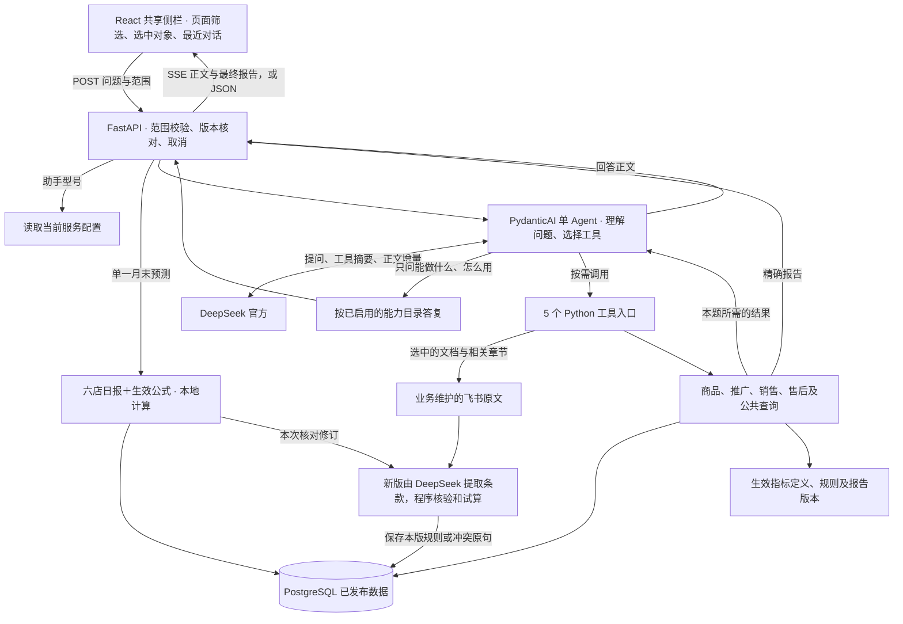

# 看板 AI 问答 · 开发设计

五页共用一个右侧助手。运营可以从商品行问“这款近七天表现怎么样”，接着问“异常在哪、先查什么”，再看同款推广。助手沿用看板的商品身份、指标和规则，回答时给出依据。固定指标和规则提醒继续放在原页面，模型只在用户提问时运行。

## 架构

| 已在本机使用                                                                               | 下一版设计                                         | 后续接入条件                                                                |
| ------------------------------------------------------------------------------------------ | -------------------------------------------------- | --------------------------------------------------------------------------- |
| 五页共用工具。经营问题查证据，现象解释可一轮交付。重复查询收尾，SSE 流式展示，记录分段耗时 | 扩展结构化回答元数据前，先验证流式兼容及跨系统需求 | 动作型飞书 SOP 需稳定只读身份。公司共享需完成调用方鉴权、会话隔离及数据授权 |

FastAPI 管请求生命周期，PydanticAI 负责“选工具 → 看结果 → 回答或补查”的循环。模型只接触获准的业务工具。金额、排行、风险命中和评分沿用领域程序。经营工具读取应用库已发布数据，口径工具读取同一套定义。首版采用单 Agent 和进程内函数调用，独立规划、反思模型、多 Agent 及自建通用 Harness 均不在范围内。[领域工具](../../apps/api/app/modules/assistant/catalog.py) · [Agent 与提示词](../../apps/api/app/modules/assistant/chat.py) · [数据契约](../data-contract.md#project-ai-contract)

## 问答工作流

全局与跟随页面共用一个 Agent。跟随只提供默认筛选，当前问题决定回答方式。型号从运行配置读取，其他问法由同一轮模型选择答复或查询。[对话处理](../../apps/api/app/modules/assistant/conversation.py)

| 用户要什么                           | 处理方式                                                                                           |
| ------------------------------------ | -------------------------------------------------------------------------------------------------- |
| 了解能做什么、怎么问、能否直接改预算 | 模型选择帮助主题，服务从已启用的能力及只读边界生成回答。查询目录供模型选工具，不会触发用户侧菜单。 |
| 讨论思路、写文案、用给定材料算比例   | 直接交付正文。普通文本和结构化通用回答共用校验。用户提供的算例不作为看板实绩。                     |
| 核对真实金额、排名或公司条款         | 查已发布的数据或适用的 SOP，再给结论。混合问题查到结果后再写建议或简报。指代不清时追问缺少的对象。 |

经营问题支持明确的月内区间。例如“11月到27日”取该月 1–27 日，省略年份用上海时区当年。“去年”“上个月”按日历换算。回答展示实际查询期间。

- **改写。** 用户可以引用当前对话范围内最近六轮中的某个回答。核对金额、百分数等带单位的数值，允许等值写法。两次改写仍改变这些信息时，摘录所指回答的原句。要求重新核实的数字或规定单独查询。
- **商品文案。** 用户说“给这款写一句”时，按选中的商品定位名称。只给品类时用场景写文案。要求一条且模型给出多个备选时，优先交付一条有材料支持的成品。常见规格和功能声称缺少依据时最多重写一次。

1. **确定对象和期间。** 优先采用提问中明确的业务和对象，引用上文时采用对应轮次的范围，快捷提问采用当前生效的页面筛选。商品页问“最近表现呢”看当前商品，明确问“店铺销售呢”就查销售。刚看完商品风险，切页问“刚才那条规则的阈值呢”仍解释该条风险。“今天先查什么”沿用经营期间，“今天的成交是多少”取当日。明星店铺和商品推广之间的预算比较使用店铺推广渠道数据。同名商品先让用户选店铺和链接。运营中心综合问题按需选域。仅在用户明确扩大范围时放宽筛选，多选范围无法准确映射到另一个业务时先澄清。
2. **选择最少的查询。** 明确询问单店月目标时直接引用已生效的销售目标口径；询问渠道月度进度时按发布版本查目标。月末 GMV 预测先核对飞书修订，再按本地日报计算。复合问题按需补查其他业务。默认按当前业务提供简短目录，跨域按需发现。五个入口分别负责找商品、单款经营、单款推广、发现业务能力及通用业务查询，承载经营查询、公共 SOP 和六店月末预测。同轮相同范围和版本复用结果。模型读取紧凑摘要，完整报告留给侧栏。售后工具共享页面已有的固定输入缓存，沿用原始报告版本、角色与窗口作为键，独立生成本题报告。
3. **根据证据回答。** 经营问题缺依据时可在同一预算内补查一次。对单款缺记录、真实零、覆盖不全和相关性的条件性解释，由模型选择对应主题，服务端直接交付。连续两批工具的名称、参数和结果都重复时，下一次模型请求收尾。换对象、翻页和取得新结果仍可继续。缺定义说明哪条未定义，缺经营记录说明实际覆盖，范围有歧义只问影响答案的条件。
4. **交付正文和依据。** 有完整依据就回答，有部分依据就说明可确认的部分及剩余缺口。停止或连接中断保留已见文字，后续历史只纳入已完成的回答和明确的待选、待答状态。

| 运营在问什么                         | 采用什么依据                                            | 预期回答                                                                                                                                       |
| ------------------------------------ | ------------------------------------------------------- | ---------------------------------------------------------------------------------------------------------------------------------------------- |
| “这款近七天表现怎样？”               | 同店同链接两期指标及覆盖                                | 结论在前，只列解释变化所需的数字和日期。缺两天就按已观察日比较                                                                                 |
| “这款为什么命中？阈值呢？”           | 命中时的实际值、比较窗口、适用规则及版本                | 说清哪项超过哪条线。只问规则定义时只读取生效定义                                                                                               |
| “我说的是没记录，有可能那天经营不好” | 已明确的对话语境                                        | 同店其他款当天有记录时，可将该款缺记录视为销售偏弱的线索。确认在售、成交明细完整且仅成交才出行后，可判当天无成交；判断是否反常还要比较平时销量 |
| “接下来先做什么？”                   | 当前异常、已发布的规则动作、相关 SOP 条款与可复查的指标 | 给一两步具体核查。流量下降而点击率稳定，先看流量入口和投放状态，素材原因仍待核查                                                               |

**提示词约束**

承接本轮对象和待答问题，只查询回答所需资料。区分观测值、规则命中、待核查原因和建议动作。六店合计、万元换算、退款率区间和上下界差值由程序提供。单店目标以正式发布粒度为准。商品风险分别提供评估日成交、所选期间累计成交和规则估算影响。追问上轮点名的一款，按链接、店铺、期间和版本重查，无法唯一定位时请运营选款。缺记录与真实零分别处理。收到的业务资料作为证据使用。

## 五页用例与数据边界

| 页面     | 常用问题与可用数据                                                                                                                                                            | 答案边界                                                                                            |
| -------- | ----------------------------------------------------------------------------------------------------------------------------------------------------------------------------- | --------------------------------------------------------------------------------------------------- |
| 运营中心 | “哪些事项优先？”组合商品风险与推广诊断。“更新到哪天？”查各域状态。天气按已发布公报解释                                                                                        | 保留各域实际窗口和等级。天气与销量的因果、全域统一评级缺少依据                                      |
| 商品数据 | 按名称、ID 或“分析这款”定位。页面已选期间可直接使用；问“近七天”时以领域已发布截至日取七天，与前七天比。看两期经营、逐日访客和转化、风险、排行、新品分项及缺项，再追问同款推广 | 评分有试行范围。库存、利润、价格活动和评价历史尚有缺口。日度风险和 SOP 七日比较分别解释             |
| 推广分析 | “钱花多了，成交跟上了吗？”按店铺或商品模式看渠道、花费、曝光、点击、转化、归因成交、实际及净投产                                                                              | 诊断窗口单列。缺净成交的渠道保留缺项。缺利润、库存或投放记录时只能建议核查                          |
| 店铺销售 | “哪家店拉动增长？本月目标还差多少？”看贡献金额、月度 GMV 目标、评级、趋势及地区明细                                                                                           | 用数据截至日核对月累计。店铺地区成交与商品地区实发实退各用自己的期间。GSV、毛利、阶段计划需对应数据 |
| 售后分析 | “本期三率怎样？哪些款集中在尺码或质量问题？”读所选报告、上期或同期、品类／款式、件数及原因                                                                                    | 按实际周／月报告覆盖。款式到店铺链接映射、质检与整改记录尚缺。父子金额分别统计                      |

商品、推广、售后交叉分析先核对业务键、期间和覆盖。有库存导航入口的商品仍需 SKU 映射、库存来源和共享库存口径才能做缺货判断。已有字段及口径见[数据契约](../data-contract.md#project-ai-contract)。

## 会话与展示

- **侧栏。** 顶栏共用入口，默认收起。桌面初始宽 440 px，沿分界线拖动，双击复位。宽屏并排、窄屏抽屉、手机全屏。左右面板各自的宽度和开合状态跨页保持，刷新或重新进入恢复默认。收起保留草稿和对话。顶部一行显示当前已应用的页面筛选，右侧“跟随页面”默认开启。关闭后显示“全局问答”，不带入页面筛选。切页、切模式均保留草稿与聊天，已发出的问题使用发送时快照。快捷提问随当前范围更新。生成中可停止。
- **短期记忆。** 客户端随请求发送最近最多六项相关历史及当前范围。页面筛选和对话主题分别维护。引用包含能力、对象、期间和版本，只用于定位。跨轮需要旧数值时按原范围最小重查，版本已变则提示更新。明确换款清旧对象，切换售后报告清旧报告引用。首版无需新增会话表或 Redis。
- **正文和图表。** Markdown 正文随 SSE 平滑显示。追问只补充新信息。每条回答共用一个默认收起的依据入口，展开先看期间、来源和本题指标或规则，长表与逐日明细按需查看。趋势或比较题有匹配指标、至少两个不同日期有值时才画一张主图。缺日断线，真实零保留，影响判断的覆盖限制随数字呈现。
- **结构化结果（下一版）。** 模型提供回答类型、正文、依据引用和完成状态。后端校验引用、对象与版本，组装指标、表、序列和用量。完成状态分完整、部分完成、需要补充。流式只展示正文增量，最终响应校验成功后入历史。对外字段以已发布协议为准。[API 接口](../api/ai-assistant.md)

## 公共 SOP 与月末预测（本地）

运营继续在同一个右侧助手提问。香草只维护飞书原文，目前登记了《拼多多月度 GMV 滚动预测 SOP》。[飞书原文](https://kocotree.feishu.cn/docx/H3svdLyEYoxsK3xgeBOceOxfnMc)

| 运营在问什么                  | 处理方式                                                                                                                                                                                 |
| ----------------------------- | ---------------------------------------------------------------------------------------------------------------------------------------------------------------------------------------- |
| 已经卖了多少、目标还差多少    | 查已发布的销售和目标数据，跳过飞书。                                                                                                                                                     |
| 有哪些 SOP                    | 直接展示本机登记的标题和适用场景。                                                                                                                                                       |
| 出现这种情况，按 SOP 先查什么 | 模型按短目录选文档。公共工具当场核对飞书修订，摘取相关原句。涉及实际表现，再查同范围的指标。同一问换关键词时沿用已核对的原文。找不到条款时，经营建议标明为模型分析。                     |
| 六店月末 GMV 是多少           | 独立任务在本次提问核对原文。同版复用已核公式，新版由 DeepSeek 提取并经程序校验、试算。后端按六店日报、月目标和已核修订算金额。冲突时给出两处原句；访问失败或无法核实新版时暂停正式金额。 |
| 换权重试试看                  | 明确给出两个窗口及各自比例，同时显示临时试算与正式预测。临时权重只用于本题。                                                                                                             |

新增做法类 SOP 只需在[短目录](../../apps/api/app/modules/knowledge/public_sops.toml)登记授权文档的标识、标题和适用场景，沿用公共查询。只有新增可执行算法或经营字段才扩展对应计算和取数。取得公共目录权限后再接自动发现。个人资料另依赖登录身份和权限。[本机配置](../development.md#forecast-sop-local) · [问答接口](../api/ai-assistant.md) · [数据范围](../data-contract.md#project-ai-contract)

## 运营试用建议

首批开放查数、定位异常、复查变化。行动类回答写清对象、证据、今天先核查的一步和复看指标。明确下调预算、改价、改尺码推荐所需的标准由业务确认。运营负责实际执行。

| 建议放行条件 | 验收方法                                                                                                                                                          |
| ------------ | ----------------------------------------------------------------------------------------------------------------------------------------------------------------- |
| 关键事实正确 | 和业务选定至少 30 道真实题，覆盖五页、跨页追问、同名款、缺数和复合问题。逐题核对对象、期间、数值、分母和区间方向，关键错误为零                                    |
| 运营能用     | 请 2–3 位运营独立试读。对十道行动题，建议至少八道能直接说出“先查什么、看什么指标复核”。无依据的预算、归因和经营承诺出现一次即回修                                 |
| 等待可接受   | 目标值建议按点击发送至正文首字的 P95 衡量：固定口径 1 秒、单域查数 5 秒、跨域综合 10 秒。分场景重复测量，覆盖冷启动与同时提问；同时记录完成耗时、失败率和未答题   |
| 公司访问可控 | 本轮按用户授权部署至现有匿名站点，HTTPS、同源检查、每分钟20次及两路并发保护。生成以随机UUID隔离停止操作，密钥只在服务端保存。按账号细分店铺权限待后续接入登录能力 |

以上为建议验收线。单机少量样本用于发现问题，公司并发、生产权限及业务可用性需在试用环境实测。[本机运营实测](../validation/2026-11-25.md#operator-pilot-review)

## 维护、上线与验收

| 责任                     | 交付要求                                                                                                                                                                 |
| ------------------------ | ------------------------------------------------------------------------------------------------------------------------------------------------------------------------ |
| 看板后端                 | 维护 FastAPI 接口、工具、预算、模型适配及取消逻辑。框架和依赖锁版本。升级框架、模型或提示词先用同题同版本数据复测，异常可回退上一组配置和依赖                            |
| 业务与各域数据提供方     | 业务确认 SOP 是否适用。数据提供方维护只读查询、业务键、指标定义、发布时间和权限。新平台提供自己的受控查询适配，优先复用 HTTP 协议。需要给 MCP 客户端供数时再包装同一查询 |
| 公司共享维护方（待指定） | 开放前落实身份、用户与平台范围、会话和取消操作隔离、并发额度、外发许可、HTTPS、监控和回退。模型通过获准的 DeepSeek 官方入口                                              |
| 验收                     | 用同一批真实问题对齐页面数字、期间、规则和动作。覆盖五页、跨页追问、纠错、同名选款、缺记录／真实零、版本变化、预算耗尽和取消。先用受控模型，再抽测获准供应商             |

使用固定题库核对对象、数字和可复查的动作。运行参数与协议示例各在对应手册维护。[运营复测题库](../validation/2026-11-24.md#assistant-question-bank)

**下一版优先级**按可测量的用户问题排序。按解释、单域和综合问题分别积累用量、正确率及首字延迟样本，再决定是否调预算或优化具体查询。单次测试值见[同题对照与 Chrome 验收](../validation/2026-11-25.md#assistant-latency-fix)。[本机验证](../validation/2026-11-24.md#assistant-explanations-ux) · [延迟基线](../validation/2026-11-25.md#assistant-latency-audit) · [运行配置](../development.md#ai-runtime) · [框架选型记录](ai-reusable-assistant-research.md)
